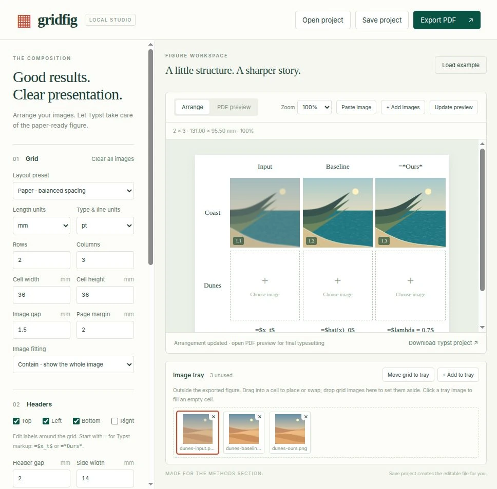

#  Gridfig 

Simple tool to turn image grids into paper-ready PDF figures.
- For very lazy people _(I don't use it)_.
- No Typst coding required.



## Install

Requires Python 3.10+, [Typst 0.14+](https://typst.app/open-source/) on your PATH,
and [pipx](https://pipx.pypa.io/stable/installation/).
Download or clone this repository, then run from its folder:

```sh
pipx install '.[images]'
```

## Launch

```sh
gridfig
```

Open the localhost URL printed in the terminal. Stop with **Ctrl+C**.
Run `gridfig doctor` to check dependencies.

## Notes

- Drag, drop, browse, paste or import folders. Keep unused images in the tray.
- Add equations and headers on any side; adjust units, fonts, sizes and spacing.
- Import PNG, JPEG, SVG, WebP or GIF (first frame). PDF import is unsupported.
  Export preserves resolution; lossless is the default, with optional lossy JPEG.
- **Save project** keeps images and settings in `.gridfig.json`; no manual JSON
  editing needed. Everything runs locally. There is no autosave—save before closing.
- Limits: 100 cells, 200 tray images, 30 MB per image and 80 MB per encoded project.

[Quick start](QUICKSTART.md) · [Advanced usage](docs/advanced.md) · [MIT-0 license](LICENSE)
